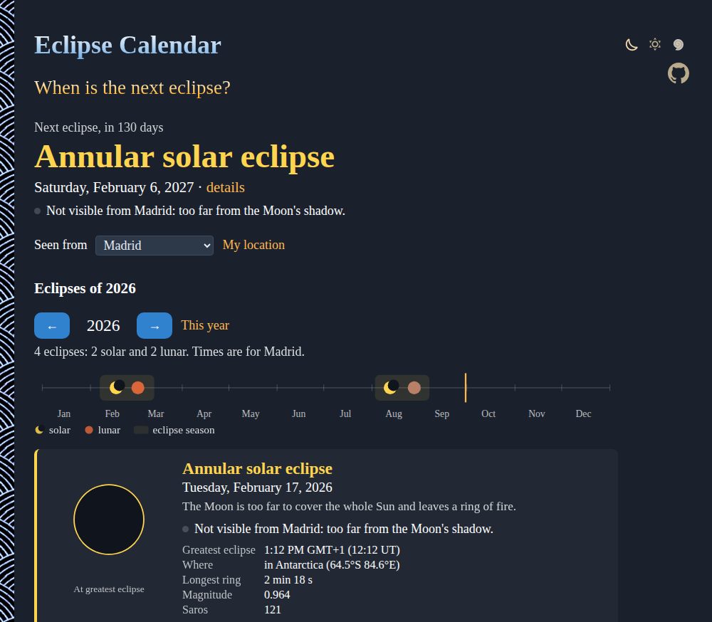

# Eclipse-Calendar

When is the next eclipse? Every solar and lunar eclipse from 1900 to 2100, right in your browser: its type, time, where it is seen best, how long it lasts, its Saros series, and what it looks like from your city. No sign-up and no libraries.

- [See the eclipses](https://evoluteur.github.io/eclipse-calendar/)
- Any year: add `?year=2045` to the address, or use the arrows (or the arrow keys)
- Any city: pick one in "Seen from", or use your location

## What it does

- **The next eclipse**: its type, date and how many days away, and whether you can see it.
- **The year**: the eclipses on a timeline, with the two eclipse seasons shaded, then a card for each one.
- **Solar eclipses**: the time and place of greatest eclipse, the longest totality or ring of fire, the magnitude, and from your city how much of the Sun the Moon covers, when, and how high the Sun is. If you are in the path, how long totality lasts where you are.
- **Lunar eclipses**: where the Moon is overhead at the maximum, how long the total, partial and penumbral phases last, with your local times, and whether the Moon is up to see it.
- **Diagrams**: the Sun and the Moon as seen from your city (or from the point of greatest eclipse), and the Moon's path through the Earth's shadow.

Times are shown in the time zone of the chosen city.

## How it is computed

Everything is computed in the browser, in [js/astro.js](https://github.com/evoluteur/eclipse-calendar/blob/main/js/astro.js), with the methods of Jean Meeus's _Astronomical Algorithms_.

- **The eclipses** (chapter 54): for each new and full moon close enough to a node of the Moon's orbit, the time of maximum, _gamma_ (how far the shadow's axis passes from the Earth's center) and _u_ (the size of the umbra). They give the type (total, annular, hybrid, partial, penumbral), the magnitude and the durations of a lunar eclipse.
- **The Sun and the Moon** (chapters 25 and 47, the Moon from its 90 main terms): their positions place the eclipse on the Earth. The point of greatest eclipse is where the shadow's axis meets the Earth, at the distance gamma from its center.
- **From a city**: the Moon's position relative to the Sun, seen from the city minute by minute, gives the contacts, the part of the Sun covered, and the duration of totality. For a lunar eclipse, the Moon's altitude at each contact tells if it is up.
- **The Saros**: eclipses 223 lunations apart are in the same series, and 358 lunations (an inex) is the step to the next series, from a known eclipse of each kind.
- **Delta T**, the drift of the Earth's rotation, from the polynomials of Espenak and Meeus.

The results are within a minute or two of NASA's eclipse catalog. For example, for the total solar eclipse of 2024-04-08 it finds the greatest eclipse at 25.2°N 104.2°W (NASA: 25.3°N 104.1°W) with 4 min 30 s of totality (4 min 28 s), and from Dallas totality at 1:43 PM. Near the edges of a path of totality, use a detailed map.

## How it is built

Plain HTML, CSS and JavaScript, with no dependencies and no build step. Just open `index.html`. The diagrams are SVG. The three color themes (dark, light and blue) are shared with my other projects (copied from [omg-themes](https://github.com/evoluteur/omg-themes)).

Eclipse-Calendar is open source at [GitHub](https://github.com/evoluteur/eclipse-calendar) with MIT license.

Had fun browsing the app? [Buy me a coffee by becoming a sponsor](https://github.com/sponsors/evoluteur).

You may also be interested in my other projects [Moon-Phase-Calendar](https://github.com/evoluteur/moon-phase-calendar) ([demo](https://evoluteur.github.io/moon-phase-calendar/)), [Mercury-Retrograde](https://github.com/evoluteur/mercury-retrograde) ([demo](https://evoluteur.github.io/mercury-retrograde/)) and [Music-of-the-Spheres](https://github.com/evoluteur/music-of-the-spheres) ([demo](https://evoluteur.github.io/music-of-the-spheres/)). For more mystic arts as small web apps, see [Esoterica](https://evoluteur.github.io/esoterica.html).

Copyright (c) 2026 [Olivier Giulieri](https://evoluteur.github.io/).
